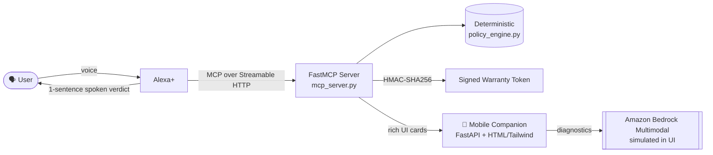

<div align="center">

# 📦 ReturnReady

### Stop the return before it happens. Fix the product before it ships back.

**An Alexa+ shopping and post-purchase triage simulator with a Split-Screen UX.**

[](LICENSE)
[](https://modelcontextprotocol.io)
[](#-tracks--mini-challenges-claimed)
[](#-tech-stack)
[](#-open-source-the-policy-engine)

</div>

---

## 💡 The Pitch

Most voice shopping assistants are a boring FAQ bot: you ask, it reads a paragraph, you forget it.

**ReturnReady** takes a different approach. It is a **Split-Screen experience**:

- 🎙️ **Alexa+ handles intent** and gives a **one-sentence spoken verdict**.
- 📱 **A Mobile Companion screen instantly receives rich UI cards** with the evidence, the options, and the next action.

It works at both ends of the purchase lifecycle:

| Phase | What ReturnReady does | Outcome |
|---|---|---|
| **Pre-purchase** | Risk matchmaking: matches the shopper's needs, environment, and history against product risk factors | Prevents the return before the order is placed |
| **Post-purchase** | Automated **10-second hardware diagnostics** triage | Fixes the issue or confirms a legitimate defect without a call center |
| **Warranty** | Issues **HMAC-SHA256 cryptographically verified claim tokens** | Tamper-evident, instantly verifiable claims |

---

## 🏆 How It Meets the Judging Criteria

### ⚙️ Technological Implementation

- **Model Context Protocol (spec `2025-11-25`)** served over **Streamable HTTP** via **FastMCP**. This is the current transport, not the deprecated SSE one.
- **Deterministic policy engine** (`policy_engine.py`) separated from the LLM. Business logic is plain, testable Python.
- **HMAC-SHA256 signed warranty tokens**, with the secret injected via `RETURNREADY_SECRET`, so claims cannot be forged or edited client-side.
- **Open-standards agent packaging** with `.kiro/config.json` and local Agent Skills (`SKILL.md`), with no proprietary cloud lock-in.
- **Pytest boundary tests** covering the policy engine's edge cases.
- **Bedrock-ready design**: the multimodal diagnostic step is architected for Amazon Bedrock Multimodal and is **currently simulated in the UI** (see [Honest Scope](#-honest-scope--roadmap)).

### 🎨 Design: The Split-Screen UX

Voice is great for intent and terrible for detail. Screens are the opposite. We use each for what it does best.

| Channel | Role | Constraint we enforced |
|---|---|---|
| 🎙️ **Alexa+** | Understand intent, deliver the verdict | **One spoken sentence.** No monologues. |
| 📱 **Mobile Companion** | Receive rich UI cards (risk breakdown, diagnostic steps, claim token) | Instant push; the user never has to ask "what did you say?" |

The result is a hands-free conversation that never becomes a wall of audio, and a screen that is never a dead-end form.

### 🌍 Potential Impact

Returns are among the most expensive parts of e-commerce. Every returned item triggers **reverse logistics**: shipping, inspection, restocking or write-off, plus customer-support handling. ReturnReady attacks that cost from two directions:

- **Avoidance (pre-purchase):** a mismatched purchase that never ships back costs nothing in reverse logistics.
- **Deflection (post-purchase):** many "defective" returns are setup or configuration problems. A 10-second diagnostic resolves them in the home or routes the case straight to a verified warranty claim, skipping the unnecessary round trip.
- **Fraud and dispute reduction:** signed tokens make claims verifiable on the spot.

This benefits **customers** (faster resolution), **sellers** (lower return rates), and **the planet** (fewer unnecessary shipments).

### 🧠 Quality of the Idea: A Rules Engine Behind the LLM

> **The LLM talks. The rules engine decides.**

Most LLM shopping agents let the model improvise policy: "Sure, that's covered!" ReturnReady does not. The LLM is responsible for **understanding the user and phrasing the answer**; every eligibility, risk, and warranty decision comes from a **deterministic, auditable, tested policy engine**.

- ✅ Same input, same verdict. Every time.
- ✅ No hallucinated refunds or invented warranty terms.
- ✅ Policy changes are a code diff and a test, not a prompt-tuning gamble.

---

## 🧩 Tracks & Mini-Challenges Claimed

- [x] **Main Track: Alexa+**
- [x] **AWS Builder Mini-Challenge**: Built on **Kiro Crew open standards** (`.kiro/config.json` plus local Agent Skills in `SKILL.md`), avoiding cloud dependency. Designed for **Amazon Bedrock Multimodal** (currently simulated in the UI).
- [x] **Open Source Mini-Challenge**: `policy_engine.py` is **MIT-licensed** and covered by **Pytest boundary tests**.
- [x] **Friction Log Bonus**: two logs below.

---

## 🏗️ Architecture



---

## 🛠️ Tech Stack

| Layer | Technology |
|---|---|
| Language | Python |
| Agent tool server | **FastMCP** (MCP SDK v1.x, `mcp[cli]<2`) |
| Protocol | **Model Context Protocol `2025-11-25`**, **Streamable HTTP** |
| Companion web app | **FastAPI** + Uvicorn |
| Frontend | HTML + **Tailwind CSS** |
| Security | **HMAC-SHA256** signed warranty tokens |
| Agent packaging | **Kiro Crew** open standard: `.kiro/config.json`, `SKILL.md` |
| Testing | **Pytest** (boundary tests) |
| Multimodal (planned) | Amazon Bedrock Multimodal (simulated in UI) |

---

## 🚀 Quickstart: Run Locally

**Prerequisites:** Python 3.10+ and `pip`.

### 1. Clone and enter the repo

```bash
git clone https://github.com/<your-username>/returnready.git
cd returnready
```

### 2. Set the signing secret

The warranty tokens are signed with HMAC-SHA256. Set your own secret:

```bash
# macOS / Linux
export RETURNREADY_SECRET="replace-with-a-long-random-string"

# Windows (PowerShell)
$env:RETURNREADY_SECRET = "replace-with-a-long-random-string"
```

> 💡 Generate a strong one with: `python -c "import secrets; print(secrets.token_hex(32))"`

### 3. Install dependencies

```bash
pip install -r requirements.txt
```

### 4. Start the MCP server

```bash
python mcp_server.py
```

### 5. Start the Mobile Companion (new terminal)

Remember to set `RETURNREADY_SECRET` in this terminal too.

```bash
uvicorn app:app --reload
```

If both processes default to the same port, run one on another, e.g. `uvicorn app:app --reload --port 8080`. Then open the Mobile Companion in your browser (use a phone-sized viewport to see the Split-Screen experience as intended).

### 6. Run the tests

```bash
pytest
```

---

## 🔓 Open Source: The Policy Engine

`policy_engine.py` is the heart of ReturnReady and is released under the **MIT License**. It is a pure, dependency-light module, so you can drop it into any commerce or support stack.

- **Deterministic:** no model calls, no randomness.
- **Boundary-tested:** Pytest cases target the edges (the last day of a return window, the exact warranty cutoff, thresholds, and so on), where policy bugs actually hide.

---

## 🧊 Friction Logs

Honest notes from building with the MCP tooling, submitted for the Friction Log bonus.

### 📝 Log 1: MCP SDK Versioning

| | |
|---|---|
| **Expected** | `pip install mcp[cli]` would give us `FastMCP` to build the server. |
| **Actual** | The v2.x release renamed it to `MCPServer`, so our imports failed with `ModuleNotFoundError`. |
| **Workaround** | Pinned the dependency to `mcp[cli]<2` in `requirements.txt`. |
| **Suggestion** | The documentation should clearly flag the v2.x breaking changes (the `FastMCP` → `MCPServer` rename) so newcomers following older tutorials aren't stranded. |

### 📝 Log 2: Streamable HTTP Endpoint

| | |
|---|---|
| **Expected** | The Streamable HTTP server would be reachable at `/mcp`. |
| **Actual** | The v1 Python SDK's `sse_client` defaults to `/sse`, resulting in a **404**. |
| **Workaround** | Updated the client router to enforce `transport="streamable-http"`. |
| **Suggestion** | Make the transport/endpoint pairing explicit in the SDK docs and client examples, so the default doesn't silently point at a deprecated path. |

---

## 🧭 Honest Scope & Roadmap

We would rather be upfront about what is real and what is simulated.

| Component | Status |
|---|---|
| MCP server over Streamable HTTP (`2025-11-25`) | ✅ Working |
| Deterministic policy engine + Pytest boundary tests | ✅ Working |
| HMAC-SHA256 warranty claim tokens | ✅ Working |
| Split-Screen Mobile Companion UI | ✅ Working |
| Kiro Crew config + local Agent Skills (`SKILL.md`) | ✅ Working |
| Amazon Bedrock Multimodal diagnostics | 🧪 **Simulated in UI** (architected for drop-in) |
| Live retailer catalog / order-system integration | 🗺️ Roadmap |

---

## 📁 Repository Structure

```text
returnready/
├── .kiro/
│   └── config.json        # Kiro Crew open-standard agent config
├── SKILL.md               # Local Agent Skill definition
├── mcp_server.py          # FastMCP server (Streamable HTTP)
├── policy_engine.py       # Deterministic rules engine (MIT)
├── app.py                 # FastAPI Mobile Companion
├── requirements.txt       # Pinned deps (mcp[cli]<2)
├── tests_policy_engine    # Pytest boundary tests
└── LICENSE                # MIT
```

> Adjust this tree to match your final layout before submitting.

---

## 📄 License

Released under the **MIT License**. See [`LICENSE`](LICENSE).

---

<div align="center">

**ReturnReady: Alexa+ speaks the verdict. Your phone shows the proof.**

</div>
# returnready-core

